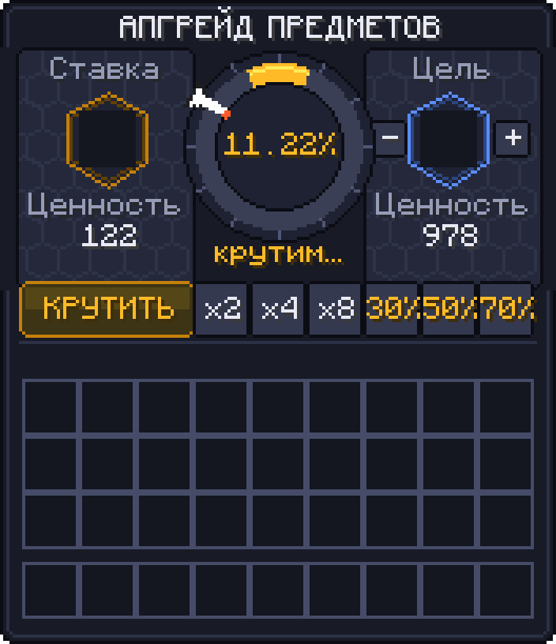

<div align="center">

# 🎰 ValqUpgrader

**Колесо апгрейда предметов для Paper 1.21.5: рискни своим предметом ради более ценного**

   



</div>

---

## ✨ Что это

Кладёшь предмет слева, выбираешь, что хочешь получить справа, и жмёшь **КРУТИТЬ**. По колесу бежит бегунок: остановился в золотой зоне, и твой предмет превращается в желаемый. Не остановился, и предмет сгорает.

Всё нарисовано собственным ресурспаком: фон меню, колесо с зоной шанса, бегунок с плавным замедлением, шанс в центре колеса. Модов игрокам не нужно, пак сервер выдаёт сам при входе.

## 🎮 Как пользоваться

| Действие | Как |
|---|---|
| Скрафтить апгрейдер | 4 золотых слитка + 4 алмаза + наковальня в центре |
| Открыть колесо | ПКМ апгрейдером |
| Поставить предмет | Кликни по предмету в своём инвентаре |
| Забрать ставку | Кликни по слоту «Ставка» |
| Выбрать цель | Кликни по слоту «Цель»: каталог всех предметов, сортировка по шансу, поиск по-русски |
| Быстрый выбор | `x2` `x4` `x8`: цель в N раз дороже; `30%` `50%` `70%`: цель под нужный шанс |
| Количество | Кнопки `−` / `+` (Shift: ±10) |

```
   G D G        G = золотой слиток
   D A D        D = алмаз
   G D G        A = наковальня
```

## 📐 Честные шансы

Цены не проставлены вручную для каждого предмета: каждый предмет оценивается **по своим рецептам** (верстак, печь, коптильня, доменка, костёр, камнерез, кузнечный стол) вплоть до сырья.

- Железный слиток стоит как его руда, незеритовый меч стоит как алмазный меч плюс незеритовый слиток.
- Побитые инструменты дешевле пропорционально прочности, а каждый уровень зачарования добавляет ценность.
- Руды, вёдра, окисленная медь, бетон и ободранные брёвна оцениваются по тому, что из них получается, поэтому абуза через шёлковое касание нет.

```
шанс = 0.9 × (ценность ставки ÷ ценность цели),  от 0.1% до 90%
```

Результат решает сервер **до** начала анимации. Бегунок всегда останавливается там, где реально выпало: проверено симуляцией на 200 000 прокруток. Каждая прокрутка пишется в `plugins/ValqUpgrader/rolls.log`.

Выигрыш сразу ложится в слот ставки, так что его можно апгрейдить дальше. Если закрыть меню или выйти во время прокрутки, результат всё равно засчитывается и придёт в инвентарь. Шалкеры и мешочки с содержимым поставить нельзя, чтобы не сгорели вещи внутри.

## ⚙️ Команды

| Команда | Что делает | Право |
|---|---|---|
| `/upgrader` | Как скрафтить | все |
| `/upgrader give [игрок]` | Выдать апгрейдер | `upgrader.admin` |
| `/upgrader open` | Открыть колесо без предмета | `upgrader.admin` |
| `/upgrader value` | Ценность предмета в руке | `upgrader.admin` |
| `/upgrader dump` | Выгрузить все цены в `values.csv` | `upgrader.admin` |
| `/upgrader reload` | Перечитать конфиг | `upgrader.admin` |

## 📦 Установка

1. Скачай `ValqUpgrader-*.jar` и `ValqUpgrader-pack-*.zip` из [Releases](../../releases).
2. Положи jar в `plugins/` и запусти сервер.
3. Залей пак на любой HTTP-хостинг и пропиши в `plugins/ValqUpgrader/config.yml`:
   ```yaml
   resource-pack:
     url: "http://твой-хост/ValqUpgrader-pack-1.0.0.zip"
     sha1: "<sha1 файла>"
     required: true
   ```
4. Для поиска по русским названиям положи `ru_ru.json` (из ассетов игры) в `plugins/ValqUpgrader/`.

В `config.yml` настраиваются house-edge, минимальный и максимальный шанс, длительность прокрутки, объявления о крупных выигрышах, чёрный список целей и цены сырья.

## 🛠 Сборка

```bash
# плагин (classpath = paper-api и его зависимости, например из libraries/ сервера)
export CP="$(find /path/to/server/libraries -name '*.jar' | tr '\n' ':')"
./build.sh plugin            # -> ValqUpgrader.jar

# ресурспак (нужны шрифты из клиента 1.21.5: assets/minecraft/font + textures/font)
python pack/gen_pack.py /path/to/extracted/client build/pack.zip
```

Генератор рисует весь пак кодом: фон, 303 состояния дуги, 120 кадров бегунка, цифры. Он же сохраняет `preview.png`.

---

<div align="center">
Сделано для <b>VALQAUYM</b> · <code>valqauym.kz</code> · <a href="https://discord.gg/valqauym">discord.gg/valqauym</a>
</div>
